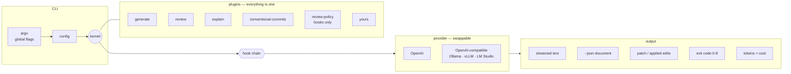

# sw-ai-developer-cli

An extensible CLI that generates, reviews and explains code with OpenAI or with
any model that speaks the OpenAI Chat Completions format, including one you run
yourself on Ollama, vLLM or LM Studio. Streaming output, CI-friendly exit codes,
token and cost accounting and a plugin API that the built-in commands are
themselves written against.

**Your code can stay on your network.** Point `--provider compat` at a model
server on your laptop, a GPU box under a desk or an on-prem cluster. Every diff,
file and prompt goes there and nowhere else. No third-party API, no key to leak,
no per-token bill and the same review gate in CI either way.



The kernel owns no commands. `generate`, `review` and `explain` are plugins
loaded on exactly the same terms as yours, which is why
`--disable-plugin review` removes `swai review` entirely. That is the cheapest
available proof that the plugin API is load-bearing rather than decorative.

---

## Try it in one command, with no API key

```bash
git clone https://github.com/CGainsWorks/sw-ai-developer-cli.git
cd sw-ai-developer-cli
make demo          # or: npm install && npm run build && npm run demo
```

The demo runs the real CLI against a real diff, with a stub provider supplied by
an [out-of-tree plugin](examples/plugins/stub-provider.mjs). No network, no
credentials, identical output every run — and it asserts the exit code of every
step, so it fails if the documented behaviour drifts.

```
$ swai review --patch-file cart.diff

src/cart.js
  error   src/cart.js:8 [correctness]
      `total` accumulates `item.price` but ignores `item.quantity`, so any line
      with a quantity above 1 is undercharged.
      suggestion:
      |     total += item.price * item.quantity;
  warning src/cart.js:12 [correctness]
      A discount code of 0 is falsy, so `if (discount)` silently skips a
      legitimate 0% code instead of applying it.
  warning src/cart.js:16 [debug-leftover]
      Debug logging left in. Use the project logger, or delete it.

3 finding(s): 1 error, 2 warning, 0 info across 1 file(s), +10/-0.
-> exit 5
```

Two of those findings came from the model. The third came from `review-policy`,
a plugin that does its work in a hook — no fork of the `review` command
required.

---

## Install

```bash
npm install -g sw-ai-developer-cli
```

Requires Node 20.10 or newer. Then choose where the model runs:

```bash
# Hosted OpenAI (the default provider)
export OPENAI_API_KEY=...

# Or a local model: nothing leaves your machine and no key is needed
ollama pull qwen2.5-coder:7b
swai --provider compat review --staged
```

No key or server is needed for `swai plugins`, `swai price`, `--help` or the
demo. The provider is constructed lazily, on first use.

---

## Usage

```bash
# Review what you are about to commit, and fail the build on an error-level finding
swai review --staged

# Review a branch against main, in a form CI can parse
swai review --base origin/main --json --fail-on warning

# Review a diff from anywhere
git diff | swai review --stdin

# Generate a file
swai generate "a debounce helper with a cancel method" -o src/debounce.ts

# Preview a patch against existing code, writing nothing
swai generate --patch -c src/server.ts "add a 30s request timeout"

# ...and apply it
swai generate --apply -c src/server.ts "add a 30s request timeout"

# Explain code, or part of it
swai explain src/output/patch.ts --lines 120:180 --detail deep
cat script.py | swai explain --language python

# Write a Conventional Commits message for the staged diff
swai commit-msg

# What is loaded, and what does it cost?
swai plugins --hooks
swai price
```

### Gating CI

```yaml
- name: AI review
  run: swai review --base origin/${{ github.base_ref }} --fail-on error
  env:
    OPENAI_API_KEY: ${{ secrets.OPENAI_API_KEY }}
```

On a self-hosted runner, the same gate can use a model server inside your
network, so the diff under review never leaves it:

```yaml
- name: AI review (on-prem model)
  run: swai --provider compat review --base origin/${{ github.base_ref }} --fail-on error
  env:
    SWAI_COMPAT_BASE_URL: http://llm.internal:8000/v1
    SWAI_COMPAT_MODEL: Qwen/Qwen2.5-Coder-32B-Instruct
```

Exit `5` fails the step. `--fail-on never` reports the same findings without
failing, which is the right setting while you calibrate.

---

## Exit codes

Stable across releases — CI gates on them, so the numbers are only ever
appended to.

| Code | Meaning |
|---:|---|
| `0` | Success |
| `1` | Unclassified error |
| `2` | Bad invocation — unknown command, missing argument, bad flag value |
| `3` | Configuration problem |
| `4` | Provider failure — auth, rate limit, network |
| `5` | Review findings at or above `--fail-on` |
| `6` | Patch did not apply cleanly |
| `7` | Token or cost budget exceeded |
| `8` | A plugin failed to load, or registered a conflicting name |

---

## Token and cost accounting

Every model call is recorded and reported to stderr, so it never contaminates
piped output:

```
info: 1 call · 4,182 in · 863 out · $0.0425
```

Under `--json`, the same figures are part of the document. Budgets abort the run
with exit `7`:

```bash
swai review --base origin/main --max-usd 0.50
swai review --base origin/main --token-budget 200000
```

`swai price` prints the effective table. A model with no price entry is reported
as `unknown` rather than `$0.00` — an unknown cost must never look like a free
one. Add your own with `pricing` in the config file.

The `compat` provider is the exception, by declaration rather than by accident:
it prices every model it serves at `providerConfig.compat.price`, which defaults
to zero because a model on your own hardware has no per-token bill. Token counts
are still recorded, so `--token-budget` works the same. For a hosted
OpenAI-compatible service, set `price` (or a `pricing` entry per model, which
wins) and `--max-usd` applies as usual.

---

## Configuration

`swai.config.json`, `.swairc.json` or `.swairc`, found by walking up from the
working directory. Precedence, lowest to highest: **defaults → config file →
environment → CLI flags.**

```jsonc
{
  "provider": "openai",
  "model": "gpt-4o",
  "maxTokens": 8192,
  "stream": true,

  "review": {
    "failOn": "error",              // error | warning | info | never
    "maxComments": 50,
    "exclude": ["package-lock.json", "dist/"]
  },

  "budget": { "maxUsd": 1.00, "maxTokens": 500000 },

  // Override or add model prices, in USD per 1M tokens.
  "pricing": { "my-model": { "input": 1.5, "output": 6 } },

  // Settings for a provider, keyed by provider id.
  "providerConfig": {
    "compat": {
      "baseUrl": "http://localhost:11434/v1",
      "model": "qwen2.5-coder:7b",
      "apiKeyEnv": "SWAI_COMPAT_API_KEY",   // the variable's name, never the key
      "price": { "input": 0, "output": 0 }
    }
  },

  // Directory of prompt template overrides; unlisted templates fall back to the packaged ones.
  "templatesDir": "./prompts",

  "plugins": ["./tools/house-style-plugin.mjs", "swai-plugin-jira"],
  "pluginConfig": {
    "review-policy": {
      "escalate": { "security": "error" },
      "dropCategories": ["style"],
      "maxPerFile": 10,
      "forbiddenPatterns": [
        { "pattern": "\\bTODO\\b", "message": "TODO left in a shipped change", "severity": "warning" }
      ]
    }
  }
}
```

Environment: `SWAI_PROVIDER`, `SWAI_MODEL`, `SWAI_MAX_TOKENS`, `SWAI_PLUGINS`,
`SWAI_MAX_USD`, `SWAI_LOG_LEVEL` and `SWAI_JSON`. The `compat` provider also
reads `SWAI_COMPAT_BASE_URL`, `SWAI_COMPAT_MODEL` and `SWAI_COMPAT_API_KEY_ENV`.

Relative plugin paths and `templatesDir` resolve against the **config file**,
not the working directory.

---

## Writing a plugin

A plugin is a plain object. No build step, no imports required:

```js
// my-plugin.mjs
export default {
  name: 'hello',
  apiVersion: 1,
  commands: [{
    name: 'hello',
    description: 'Say hello',
    args: [{ name: 'who', description: 'Who to greet' }],
    run: (ctx) => {
      ctx.out.line(`hello ${ctx.args.who ?? 'world'}`);
      return { exitCode: 0, data: { greeted: ctx.args.who ?? 'world' } };
    },
  }],
};
```

```
$ swai --plugin ./my-plugin.mjs hello reviewer
hello reviewer
```

Plugins can contribute **commands**, **providers**, and **hooks** into other
commands — `beforeModelCall` to rewrite prompts, `reviewComments` to filter or
add findings, `beforePatch` to veto a write.

**[Full plugin guide →](docs/PLUGIN_GUIDE.md)** ·
**[Prompt design notes →](docs/prompt_design.md)**

---

## Providers

One interface, two implementations, no command-level knowledge of either:

| | OpenAI | OpenAI-compatible |
|---|---|---|
| Flag | `--provider openai` (default) | `--provider compat` |
| Runs on | OpenAI's hosted API | Ollama, vLLM, LM Studio, llama.cpp server, or any hosted gateway with the same API |
| Where your code goes | OpenAI | Wherever you point it: your machine, your network |
| Key | `OPENAI_API_KEY` | Optional. `SWAI_COMPAT_API_KEY`, or any variable named by `apiKeyEnv` |
| Base URL | OpenAI's | `SWAI_COMPAT_BASE_URL` or `providerConfig.compat.baseUrl`; default `http://localhost:11434/v1` (Ollama) |
| Default model | `gpt-4o` | `qwen2.5-coder:7b`; set `--model`, `SWAI_COMPAT_MODEL` or `providerConfig.compat.model` |
| Output ceiling field | `max_completion_tokens` | `max_tokens` |
| Cost | Built-in price table | `providerConfig.compat.price`, default zero |
| Structured output | `response_format` strict mode | `response_format`, where the server supports it |

Both share one implementation of the Chat Completions wire format
([`chat-completions.ts`](src/providers/chat-completions.ts)), so streaming and
token accounting behave identically. The `compat` provider never sends your
`OPENAI_ORG_ID` or `OPENAI_PROJECT_ID` to the server it talks to. An unreachable
server is reported as such, with a hint, under exit `4`.

A model that cannot be schema-constrained raises a distinct error, and `review`
retries unconstrained and recovers the JSON from the text, rather than failing
a review you asked for. Self-hosted servers word that refusal in many ways, so
under `compat` any HTTP 400 or 422 on a schema-constrained request is treated
the same way.

Adding a third provider is a plugin, not a fork. See the
[worked example](examples/plugins/stub-provider.mjs).

---

## Development

```bash
./scripts/setup.sh      # or scripts\setup.cmd on Windows
make check              # typecheck, coverage, build, demo — what CI runs
make help               # all targets
```

CI runs the full matrix on **Linux, macOS and Windows** across **Node 20, 22 and
24** — 9 jobs — plus a packaging job that installs the built tarball into a
clean directory and runs it, which is what catches a `files` list that forgets
to ship the prompt templates.

Releases are automated with semantic-release from Conventional Commits on
`main`. `make release-dry` shows what would be published without publishing.

### The numbers

| | |
|---|---|
| Tests passing | **311 / 311** across 13 files |
| Statement coverage | **96.51%** |
| Branch coverage | **90.71%** |
| Function coverage | **95.18%** |
| Enforced floors | 85% statements/lines/functions, 80% branches |

Reproduce all of it:

```bash
npm run numbers
```

No figure appears in this README unless that script prints it. The thresholds
are enforced in `vitest.config.ts`, so they are floors the build fails below —
not a snapshot that quietly rots.

---

## Limitations

Stated plainly, because the failure modes matter more than the feature list.

- **Review quality is model quality.** The tool structures, validates and gates
  the output; it does not make the model a better reviewer. Expect a useful
  second pair of eyes on a diff, not a replacement for one. Treat findings as
  candidates.
- **Reviews see the diff, not the codebase.** There is no repository indexing or
  retrieval. A bug whose cause is in an unchanged file two directories away will
  not be found, and the prompt explicitly tells the model not to guess about
  code it cannot see.
- **`--fail-on error` needs calibration before you gate on it.** Severity is
  assigned by the model. Run with `--fail-on never` for a while on real PRs
  first, and use `review-policy` to escalate or drop categories to taste.
- **Patch application is best-effort.** Context is matched within a search
  window around the stated position, so a slightly stale diff still applies. A
  hunk that cannot be placed is rejected and the file is left untouched — a
  file is never half-applied — but review a patch before `--apply`.
- **Binary and rename-only diffs are skipped**, not patched.
- **Prices drift.** The built-in table was correct when written and is
  overridable via `pricing`. Unknown models report `unknown`, never `$0.00`.
- **A local model is only as good as the model.** The `compat` provider gives a
  small model on a laptop the same prompts as a large hosted one. Expect
  noisier reviews from small models and calibrate `--fail-on` per model.
- **Token counts under `compat` depend on the server.** Usage is requested on
  streamed responses. A server that does not report it is recorded as zero
  tokens; if that happens, `--no-stream` usually gets real counts.
- **`compat` has been unit-tested against a stubbed client, not against each
  server.** Ollama, vLLM and LM Studio all document this API. Differences in
  what they accept (for example `response_format`) are handled by falling
  back, not by per-server code.
- **Budgets stop after the ceiling is crossed, not before.** Output length is
  not knowable in advance, so a pre-flight check would be a guess. The guarantee
  is "stop as soon as it is exceeded".
- **No retry or backoff.** A rate limit surfaces as exit `4`. Retrying belongs
  to the caller, which in CI is usually the right place for it.
- **Plugins are not sandboxed.** A plugin is imported into the CLI process and
  can do anything Node can. Treat installing one as you would any dependency.
- **Not published to npm yet.** The release pipeline is configured and
  `make release-dry` works, but the package name is unclaimed until the first
  release runs.

---

## Licence

MIT — see [LICENSE](LICENSE).
